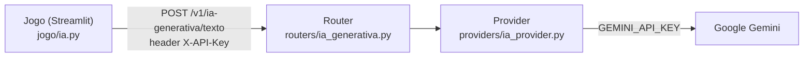

# O Interrogatório — Detetive de Mentiras

Jogo de dedução por texto feito em Streamlit: uma IA gera um caso policial e o jogador interroga
um suspeito (também controlado por IA) em até 6 perguntas livres. No final, faz uma acusação
(qual foi a mentira e o que realmente aconteceu) e recebe uma nota de 0 a 2.

Este repositório é a entrega da **CP5 de Front-end**. O jogo é o MVP da CP5 de PLN (Prof. Sergio),
adaptado para que a chamada à IA generativa saia do código do jogo e vá para um **back-end
FastAPI próprio do grupo**.

## Integrantes

| Nome | RM |
|---|---|
| Henry Gimenez da Costa | 563217 |
| Vinícius Alef Araújo Cruz | 564504 |

## Vídeo

**Link do vídeo:** https://www.youtube.com/watch?v=hjRCs79JN5o

## Arquitetura

O repositório tem dois projetos independentes, cada um com seu `requirements.txt` e seu `.env`:

```
jogo_cp/
├── backend/                     API FastAPI (porta 8000)
│   ├── main.py                  cria o app, CORS, /health, inclui o router
│   ├── auth.py                  autenticação por header X-API-Key
│   ├── config.py                lê o .env (GEMINI_API_KEY, API_KEY, CORS_ORIGINS)
│   ├── routers/ia_generativa.py rota POST /v1/ia-generativa/texto
│   ├── providers/ia_provider.py única parte que chama o Gemini (google-genai)
│   └── tests/test_api.py        testes da API (pytest + TestClient)
└── jogo/                        jogo Streamlit (porta 8501)
    ├── app.py                   telas: menu, interrogatório, acusação, resultado
    ├── ia.py                    chama a API do grupo via requests, retry e modo offline
    ├── prompts.py               os 3 prompts do jogo
    ├── config.py                lê o .env (IA_API_URL, IA_API_KEY)
    └── tests/test_mecanicas.py  testes das mecânicas (API mockada)
```



- O **jogo** não conhece mais a chave do Gemini e não importa o SDK do Google. Ele só monta o
  prompt e chama a API do grupo com `requests` (função `_chamar` em [jogo/ia.py](jogo/ia.py)).
- O **router** valida o corpo da requisição, exige a `X-API-Key` e traduz erros em códigos HTTP.
- O **provider** é o único lugar que fala com o Gemini. Para trocar de provedor de IA, só ele muda.

### Endpoint

`POST /v1/ia-generativa/texto` — protegido pelo header `X-API-Key`.

Requisição:

```json
{
  "prompt": "Você é o suspeito... Pergunta do jogador: onde você estava às 22h?",
  "json_mode": false,
  "pensar": false
}
```

| Campo | Tipo | Descrição |
|---|---|---|
| `prompt` | string (obrigatório) | Contexto montado pelo jogo |
| `json_mode` | bool (padrão `false`) | Pede ao modelo uma resposta em JSON puro (usado na geração do caso e na avaliação) |
| `pensar` | bool (padrão `true`) | Liga o *thinking* do modelo (usado só na geração do caso) |

Resposta `200`:

```json
{ "texto": "Eu estava em casa, já disse isso.", "modelo": "gemini-3.5-flash" }
```

| Código | Quando |
|---|---|
| `200` | Texto gerado |
| `401` | `X-API-Key` ausente ou errada |
| `422` | Corpo inválido (ex.: `prompt` vazio) |
| `502` | O Gemini falhou |
| `503` | Backend sem `API_KEY` ou `GEMINI_API_KEY` configurada |

Também existe `GET /health` (sem autenticação) e a documentação automática em
**http://127.0.0.1:8000/docs** (Swagger). No Swagger, clique em **Authorize** e informe a
`API_KEY` para testar a rota.

O CORS libera as origens de `CORS_ORIGINS` (padrão `http://localhost:8501`, o Streamlit).

## Requisitos

- Python 3.10 ou superior (testado com 3.14)
- Chave gratuita da API do Gemini: https://aistudio.google.com/apikey

## Como rodar (Windows, PowerShell)

São **dois terminais**: um para a API e outro para o jogo. Suba a API primeiro.

### Terminal 1 — API (backend)

```powershell
cd backend
python -m venv .venv
.\.venv\Scripts\Activate.ps1
pip install -r requirements.txt
Copy-Item .env.example .env
# abra backend\.env e preencha GEMINI_API_KEY e API_KEY (invente uma senha)
uvicorn main:app --reload
```

A API sobe em http://127.0.0.1:8000 e o Swagger em http://127.0.0.1:8000/docs.

### Terminal 2 — Jogo

```powershell
cd jogo
python -m venv .venv
.\.venv\Scripts\Activate.ps1
pip install -r requirements.txt
Copy-Item .env.example .env
# abra jogo\.env e coloque em IA_API_KEY o MESMO valor de API_KEY do backend
streamlit run app.py
```

O navegador abre em http://localhost:8501.

> Se o PowerShell bloquear o `Activate.ps1`, rode sem ativar o ambiente:
> `.\.venv\Scripts\python.exe -m uvicorn main:app --reload` e
> `.\.venv\Scripts\python.exe -m streamlit run app.py`.
>
> No Linux/macOS: `source .venv/bin/activate` e `cp .env.example .env`.

### Variáveis de ambiente

`backend/.env`

| Variável | Obrigatória | Descrição |
|---|---|---|
| `GEMINI_API_KEY` | sim | Chave do Gemini. Só o backend usa. |
| `API_KEY` | sim | Chave que o jogo precisa mandar no header `X-API-Key`. |
| `GEMINI_MODEL` | não | Modelo usado. Padrão: `gemini-3.5-flash`. |
| `CORS_ORIGINS` | não | Origens liberadas, separadas por vírgula. Padrão: `http://localhost:8501`. |

`jogo/.env`

| Variável | Obrigatória | Descrição |
|---|---|---|
| `IA_API_KEY` | sim | Igual à `API_KEY` do backend. |
| `IA_API_URL` | não | Endereço da API. Padrão: `http://127.0.0.1:8000`. |
| `IA_API_TIMEOUT` | não | Tempo máximo de espera em segundos. Padrão: `90`. |

### Testando a API sem o jogo

```powershell
curl.exe -X POST http://127.0.0.1:8000/v1/ia-generativa/texto `
  -H "Content-Type: application/json" -H "X-API-Key: SUA_API_KEY" `
  -d '{\"prompt\": \"Diga ola em uma frase.\", \"pensar\": false}'
```

Sem o header, a resposta é `401 {"detail": "X-API-Key ausente ou invalida."}`.

## Evidência de que o jogo consome a API

Em tempo de execução, cada chamada do jogo aparece **nos dois terminais**:

```
# terminal do jogo (jogo/ia.py)
INFO [jogo.ia] POST http://127.0.0.1:8000/v1/ia-generativa/texto -> 200 (3.4s)

# terminal da API (routers/ia_generativa.py)
INFO [ia_generativa] texto gerado | json_mode=False pensar=False | 112 chars | 3.3s
INFO:     127.0.0.1:52144 - "POST /v1/ia-generativa/texto HTTP/1.1" 200 OK
```

O menu do jogo também mostra o endereço da rota usada. No código, a única saída de rede do
jogo é a função `_chamar` em [jogo/ia.py](jogo/ia.py), que faz `requests.post` para a API do
grupo. O pacote `google-genai` nem está no `requirements.txt` do jogo.

Se a API estiver desligada, o jogo não trava: entra no **MODO OFFLINE** (caso fixo e suspeito
sem IA) com um aviso na tela.

## Como jogar

1. Clique em **Começar partida**: a IA gera o caso (crime, local, horário, suspeito).
2. Faça até **6 perguntas** livres ao suspeito, que responde em personagem. Procure contradições.
3. Com as perguntas esgotadas, clique em **Fazer acusação final** e responda: qual foi a mentira e o que realmente aconteceu.
4. A IA compara com a verdade e o Python soma a pontuação (0 a 2). Você vê a verdade completa e pode jogar de novo.

## Testes automatizados

```powershell
cd backend; .\.venv\Scripts\python.exe -m pytest -v   # 9 testes da API
cd jogo;    .\.venv\Scripts\python.exe -m pytest -v   # 30 testes do jogo
```

Os testes da API cobrem autenticação (401/503), validação (422), repasse ao provider, erro do
Gemini (502) e CORS. Os testes do jogo cobrem as mecânicas e confirmam que o jogo chama a rota
certa com o header `X-API-Key`. Nenhum teste chama o Gemini de verdade, então não gastam cota.

## Documentos da CP5 de PLN

Em [jogo/](jogo/): [Entrega_CP5.md](jogo/Entrega_CP5.md) (Diário de Mudanças, checklist de
testes e Diário de Vibe Coding), [proposta_final.md](jogo/proposta_final.md) (proposta da CP4),
`evidencia_*.json` (saídas reais da IA) e `mockup_shots/` (telas).

## Segurança

Nenhuma chave está no código. Os arquivos `.env` e `.venv/` estão no `.gitignore`. A chave do
Gemini fica só no `.env` do backend; o jogo só tem a `API_KEY` do grupo.
